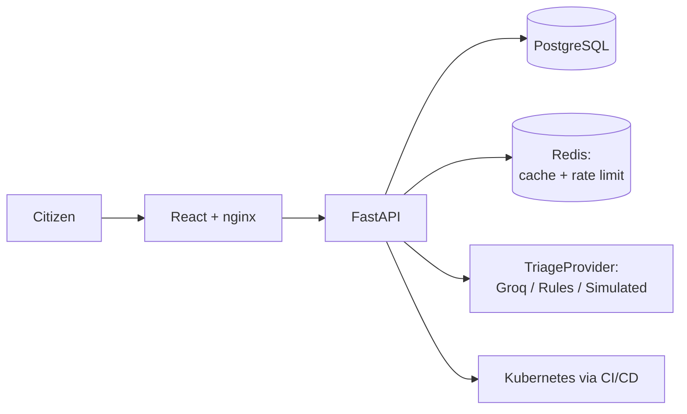

# CivicPulse — System Architecture

> Architecture index for Assignment 01 — CS4032 Software Construction and Design.
> **This file is a router, not a specification.** Read the linked domain document for the area you're working in — a UI change only needs `frontend.md`, not the Kubernetes or CI/CD documents. Detailed decisions, schemas, workflows, and configuration belong in `docs/architecture/`, never duplicated back into this file.

## Purpose

CivicPulse is an end-to-end municipal complaint intake, AI-assisted triage, persistence, and operations platform. A citizen submits a free-text complaint and location; the backend validates it, classifies it through a replaceable triage provider, persists the result in PostgreSQL, and exposes it to an operations dashboard. Redis provides read-through statistics caching and distributed rate limiting. The application runs as four cooperating containers under Docker Compose for local development, and as a scaled, probed, autoscaling workload on Kubernetes through CI/CD.

**Central principle — replaceability with controlled failure:**

- the frontend does not own domain rules;
- the backend does not depend on one specific AI implementation;
- persistence is isolated behind repositories;
- outbound integrations are isolated behind providers/interfaces;
- probabilistic AI is wrapped in deterministic validation, timeout, retry, cache, and fallback behavior;
- deployment uses immutable image references so the artifact tested in CI is the artifact deployed.



## Core stack

| Area | Choice |
|---|---|
| Frontend | React 18 + Vite + TypeScript, served by nginx (multi-stage image) |
| Backend | FastAPI + Pydantic v2, SQLAlchemy, Alembic |
| Database | PostgreSQL 16 |
| Cache / rate limiter | Redis 7 (two responsibilities, one instance) |
| AI | `TriageProvider` interface — `LLMTriage` (Groq), `RuleBasedTriage`, `SimulatedTriage` |
| Containers | Docker (multi-stage, pinned, non-root), Docker Compose |
| Orchestration | Kubernetes via k3d + Kustomize |
| CI/CD | GitHub Actions → GHCR, Trivy, kubeconform, Syft |

## Documentation map

| Domain | Covers | Document |
|---|---|---|
| Frontend | Views, runtime config, typed API client, container build | [`docs/architecture/frontend.md`](architecture/frontend.md) |
| Backend | Layering, API contract, state machine, health/readiness, observability | [`docs/architecture/backend.md`](architecture/backend.md) |
| Database | Schema, migrations, indexes, seed data, persistence | [`docs/architecture/database.md`](architecture/database.md) |
| Cache | Redis stats cache + distributed rate limiter | [`docs/architecture/cache.md`](architecture/cache.md) |
| AI | `TriageProvider`, reliability pipeline, PII policy | [`docs/architecture/ai.md`](architecture/ai.md) |
| Docker & Compose | Images, networks, volumes, compose files | [`docs/architecture/docker-compose.md`](architecture/docker-compose.md) |
| Kubernetes | Manifests, probes, rollouts, HPA/VPA, rollback | [`docs/architecture/kubernetes.md`](architecture/kubernetes.md) |
| CI/CD | Workflows, security boundaries, build-once-deploy-many | [`docs/architecture/cicd.md`](architecture/cicd.md) |
| Testing | Unit/integration/component test requirements | [`docs/architecture/testing.md`](architecture/testing.md) |
| Security | Network isolation, secrets, cross-cutting security rules | [`docs/architecture/security.md`](architecture/security.md) |
| Repository layout | Full directory tree | [`docs/architecture/repository-layout.md`](architecture/repository-layout.md) |
| Roadmap | Build-order dependency chain | [`docs/architecture/roadmap.md`](architecture/roadmap.md) |

## Cross-cutting rules (apply everywhere)

- No SQL outside repositories; no business rules in HTTP routes (the rate limiter is the one named exception — [`backend.md`](architecture/backend.md)).
- No frontend copy of backend state-transition rules.
- No secrets in source code, frontend bundles, or committed Kubernetes manifests ([`security.md`](architecture/security.md)).
- No `latest` deployment target — deploy by immutable SHA ([`cicd.md`](architecture/cicd.md)).
- No localhost-based service-to-service communication.
- No database/cache exposure through production host ports or public Kubernetes Services.
- Health semantics must match Kubernetes semantics: liveness is DB-independent, readiness is not.
- PostgreSQL is the sole source of truth for complaint data; Redis holds only derived/cache state.
- Builds are reusable across environments (build once, deploy many) — no environment-specific images.
- The repository must be understandable from a clean clone and defensible at the individual viva.

## Source-of-truth table

| Data / behavior | Source of truth |
|---|---|
| Complaint record | PostgreSQL |
| Category / priority enums | Backend model/domain |
| Status transition legality | Backend transition table |
| AI output shape | `TriageResult` Pydantic model |
| Active provider | `TRIAGE_PROVIDER` + provider factory |
| Stats aggregates | PostgreSQL queries; Redis is a derived cache |
| Triage cached result | Redis, derived from provider output |
| Frontend API types | Backend OpenAPI contract |
| Deployment artifact | Immutable image SHA/digest |
| Secret values | Runtime secret store/environment, never repo |

## Resolved either/or decisions

Where the assignment gives an implementation choice, a single decision is fixed — see each linked document for the full trade-off reasoning:

| Choice | Decision | Detail |
|---|---|---|
| Hosted AI provider | Groq only — no Ollama (instructor-approved single-path scope) | [`ai.md`](architecture/ai.md) |
| Frontend runtime config | nginx `/api` proxy, not `/config.js` | [`frontend.md`](architecture/frontend.md) |
| Rate-limit algorithm | fixed-window, 10 req/60s per IP, atomic Lua increment | [`cache.md`](architecture/cache.md) |
| Rate limiter on Redis outage | fail closed (`503`) | [`cache.md`](architecture/cache.md) |
| Stats/triage cache on Redis outage | fail open (degrade to direct query/call) | [`cache.md`](architecture/cache.md) |
| Kubernetes distribution | k3d, not kind (built-in Traefik) | [`kubernetes.md`](architecture/kubernetes.md) |
| Redis Kubernetes rollout | `strategy: Recreate` | [`kubernetes.md`](architecture/kubernetes.md) |
| Migration execution | dedicated Job/service, never an `initContainer` or app startup | [`database.md`](architecture/database.md) |
| PII / data governance | raw complaint text sent to Groq unredacted, documented | [`ai.md`](architecture/ai.md) |

## ADR map

| ADR | Decision |
|---|---|
| 0001 | Provider interface / replaceable AI triage |
| 0002 | Frontend runtime configuration — nginx `/api` proxy |
| 0003 | Deploy-by-SHA / immutable production artifact |
| 0004 | PII and data governance for hosted AI |

Recommended additional ADRs (decision already fixed above; trade-off still worth writing up): k3d vs kind; fixed-window vs token-bucket + fail-closed vs fail-open; migration Job vs initContainer; Redis AOF persistence rationale.

## Engineering questions the architecture must answer

Full answers with file/line references belong in `docs/ENGINEERING-NOTES.md`, not here:

1. What differs between a laptop and a CI runner, and which line freezes each difference?
2. Where does the CI/CD pipeline sit on the course maturity ladder, and what's the next rung?
3. Which exact line enforces build-once-deploy-many, and what fails without it?
4. What does "correct" mean for a probabilistic live LLM, and how is CI made deterministic?
5. How many seconds of HPA lag were observed, and what would reduce it?
6. Why is VPA in `Off` mode, and what feedback problem could arise with HPA in parallel?
7. How does `internal: true` affect hosted LLM access, and why is the backend the egress point?
8. What real failure cost significant time, and what command/log line found the root cause?

## Definition of done

```text
clean clone → one command → seeded four-container application
   → submit complaint → AI triage → persist → dashboard + stats
   → second command / CI deployment → Kubernetes workload
   → health/readiness/probes → HPA/VPA evidence
   → CI/CD build/scan/publish/deploy → rollback
```

README claims must correspond to actual commands/evidence.

## Viva-ready summary

The system in five layers: **Browser** (React) → **API** (FastAPI, HTTP + validation) → **Application** (services: triage, state machine, cache orchestration) → **Infrastructure** (PostgreSQL durable state, Redis cache/limiting, AI providers) → **Delivery** (Docker/Compose locally, Kubernetes at scale, GitHub Actions for test/scan/publish/deploy/rollback).

Defend these first: why the AI provider is an interface (swap the model without touching the app); why Redis is distributed (shared rate limit/cache across replicas); why `/health` and `/ready` differ (restart vs. traffic-routing are different failure domains); why Postgres is stateful; why the frontend is runtime-configured; why CI deploys a SHA; why fallback exists; why VPA is advisory.

## See also

- `docs/ENGINEERING-NOTES.md` — the 8 questions above, answered with file/line references.
- `docs/RUNBOOK.md` — operational procedures (start/stop, migrations, rollback, diagnosing failures).
- `docs/adr/` — the four required ADRs plus any recommended ones.
- `docs/Milestones.md` — detailed build-order checklist (see also [`architecture/roadmap.md`](architecture/roadmap.md) for the dependency summary).

---

CivicPulse should be treated as a small production system rather than a collection of assignment features: each component has a clear responsibility, a visible dependency boundary, a tested failure mode, and an observable operational behavior.
