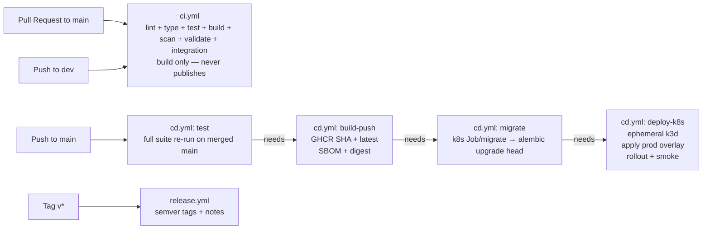

# CI/CD Architecture

> Part of the CivicPulse architecture. Root index: [`docs/architecture.md`](../architecture.md).

## Purpose

A push to `main` tests, scans, builds, publishes, and deploys an immutable artifact — the tested artifact is the deployed artifact (build-once-deploy-many). Three workflows, two branches.



`ci.yml` and `cd.yml` are separate workflows with separate triggers — a PR never reaches `BUILD`/`DEPLOY`; only a push to `main` (which only happens via an already-CI-passed, approved PR) does.

## 1. Branch model

```text
main  = deployable software
  ↑
PR review + required CI
  ↑
dev
  ↑
feature branches
```

Requirements: protected `main`; no direct pushes to `main`; pull request required; CI required; at least one approval; work should occur on `dev`/feature branches.

## 2. `ci.yml`

Triggered by: pull request to `main`; push to `dev`.

### Lint/type

Backend: Ruff; mypy. Frontend: ESLint; `tsc --noEmit`.

### Backend tests

pytest; coverage ≥65% on `app/`; `TRIAGE_PROVIDER=simulated` for deterministic behavior.

### Frontend tests

Vitest; at least 5 meaningful component tests.

### Build

Build both images. Do not publish artifacts from PR CI.

### Security scan

Trivy scans both images and fails on HIGH/CRITICAL findings **that have a fixed version available** (`--ignore-unfixed`), matching the assignment's exact gate. Failing on vulnerabilities with no available fix would block CI on issues nobody can act on yet.

### Kubernetes validation

```text
kustomize build overlays/prod
        ↓
     kubeconform
```

### Compose integration test

```text
docker compose up -d
      ↓
migrate service runs alembic upgrade head, exits 0
      ↓
wait /ready
      ↓
POST complaint
      ↓
GET complaint
      ↓
assert category
      ↓
stats request MISS
      ↓
stats request HIT
      ↓
docker compose down -v
```

This is the end-to-end application integration gate.

## 3. `cd.yml`

Triggered by push to `main`.

```text
test
  ↓ needs
build-push
  ↓ needs
migrate
  ↓ needs
Kubernetes deploy
```

### Build/publish

- build both images;
- push to GHCR;
- tag with commit SHA;
- `latest` may also be pushed for convenience, but it is never deployed;
- generate SBOM with Syft;
- capture image digest as output.

### Migrate

- create/reuse the ephemeral k3d cluster;
- **delete any previous Job first:** `kubectl delete job/migrate -n civicpulse --ignore-not-found`. A `Job`'s pod template is immutable, so re-applying `migrate-job.yaml` with a new image SHA against an existing Job (complete or not) fails with an immutable-field error, not a rerun. Deleting before applying is what makes the same static manifest name safe to reuse on every deploy;
- apply `k8s/base/migrate-job.yaml` (via the prod overlay) using the immutable SHA;
- `kubectl wait --for=condition=complete job/migrate -n civicpulse`;
- fail the pipeline if the Job fails or times out, before any backend rollout is attempted;
- the Job manifest sets `ttlSecondsAfterFinished: 300` so a completed Job is garbage-collected automatically rather than accumulating across deploys.

Full migration rationale: [`database.md`](database.md).

### Deploy

- apply the rest of the production overlay using the immutable SHA;
- wait for rollout status;
- smoke-test through Ingress (see [`kubernetes.md`](kubernetes.md));
- print HPA status.

The exact production reference should answer *"What image is production running?"* with an immutable commit SHA or digest.

## 4. `release.yml`

Triggered by tags matching `v*`. Responsibilities: build/push release images; semver tags; release notes.

## 5. CI/CD Security Boundaries

Credentials are supplied by: local `.env` for development; Kubernetes Secret for cluster runtime; GitHub Secrets for CI/CD.

Repository must include `.env.example` and ignore `.env`.

Workflow requirements:

- use a scoped/revocable registry credential or `GITHUB_TOKEN` with package write permissions where appropriate;
- add an explicit least-privilege `permissions:` block;
- do not store account passwords in workflows;
- pin Actions to at least a major version such as `@v4`; commit-SHA pinning is preferable for the bonus;
- never echo secret values into logs.

Full secret-handling rules (repo-wide, not just CI): [`security.md`](security.md).

## 6. Build Once, Deploy Many

The intended artifact flow is:

```text
source commit
   ↓
CI tests source
   ↓
build image
   ↓
push image tagged with immutable SHA
   ↓
scan/SBOM/digest
   ↓
deploy that exact image
```

The frontend is part of this principle. A production deployment should not require rebuilding the frontend merely because `/api` resolves differently in another environment. Runtime routing/configuration is therefore part of the architecture, not a frontend convenience (see [`frontend.md`](frontend.md)).

The corresponding ADR is `docs/adr/0003-deploy-by-sha.md`.

## 7. Invariants checklist

- [ ] PR CI is required for `main`.
- [ ] Tests run before publishing.
- [ ] Trivy gate exists (`--ignore-unfixed`).
- [ ] Kustomize output passes kubeconform.
- [ ] Compose integration test exists (including migration step).
- [ ] Publish/deploy/migrate jobs use `needs:`.
- [ ] GHCR images carry commit SHA tags.
- [ ] SBOM is generated.
- [ ] Deploy uses SHA/digest, never `latest`.
- [ ] Deployment runs on ephemeral k3d.
- [ ] Migration Job completes before rollout is awaited.
- [ ] Rollout is awaited.
- [ ] Ingress smoke test runs.
- [ ] GitHub Secrets are used for credentials.
- [ ] Workflow permissions are least-privilege.
- [ ] Release workflow exists for `v*` tags.
