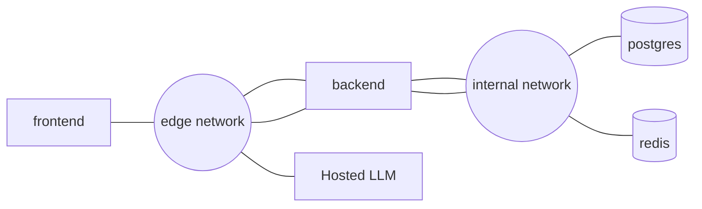

# Docker & Docker Compose Architecture

> Part of the CivicPulse architecture. Root index: [`docs/architecture.md`](../architecture.md).

## Purpose

Two multi-stage, pinned, non-root container images, run as four cooperating containers under Docker Compose for laptop development/demo. This is one command bringing up the complete seeded system.

## 1. Backend image

Base/build direction:

```text
python:3.12-slim
    ↓ builder stage
install dependencies
    ↓ runtime stage
non-root backend image
```

Required properties: multi-stage; pinned base image tag/digest; dependency-first COPY order for cache efficiency; non-root user; exec-form `CMD`; container `HEALTHCHECK`.

## 2. Frontend image

```text
node:22-alpine
    ↓ build
nginx:1.27-alpine
```

Required properties: multi-stage; pinned base images; no Node/node_modules/source in final runtime stage; nginx serves static files and optionally proxies `/api` (see [`frontend.md`](frontend.md)).

## 3. Build context hygiene

Each context gets a `.dockerignore` excluding at minimum: `.git`; `node_modules`; `.venv`; `__pycache__`; `.env`; test fixtures.

Record before/after build context sizes as assignment evidence.

## 4. Four-container topology



Network membership:

| Service | `edge` | `internal` |
|---|---:|---:|
| frontend | yes | no |
| backend | yes | yes |
| postgres | no | yes |
| redis | no | yes |

The backend is the only bridge between the two networks. The one-off `migrate` service (see [`database.md`](database.md)) joins `internal` only, alongside `postgres` — it needs no outbound access and no route from `frontend`.

## 5. Network security invariant

This command should fail:

```bash
docker compose exec frontend ping database
```

That failure is evidence of correct segmentation, not a defect. The frontend is an internet-facing component and should not have network reachability to the database.

## 6. Internal network trade-off

`internal: true` blocks outbound access from its members. Therefore:

- hosted LLM traffic must originate from the backend through `edge` (see [`ai.md`](ai.md) §Hosted LLM vs internal network);
- PostgreSQL and Redis stay on `internal` only.

## 7. Named volumes

| Volume | Consumer | Purpose |
|---|---|---|
| `pgdata` | PostgreSQL | durable complaint data |
| `redisdata` | Redis | AOF persistence |

Development may additionally bind-mount backend source for hot reload. Production must not use source bind mounts.

## 8. Compose files

Both files include a `migrate` one-off service (see [`database.md`](database.md)): `command: alembic upgrade head`, `restart: "no"`, and `backend` depends on it with `condition: service_completed_successfully`. `migrate` is not one of the "four cooperating containers" — it runs to completion during `up` and exits, the same role a `Job` plays in Kubernetes.

### `compose.yaml` — development-oriented

- can use `build:`;
- can use source bind mounts/hot reload;
- starts all required services;
- uses health checks and dependency ordering.

### `compose.prod.yaml` — production-oriented

- must use `image: ${IMAGE_TAG}`;
- must not contain `build:`;
- must not publish database/cache ports;
- uses pinned images;
- keeps persistence and network isolation;
- uses restart policies and resource limits.

## 9. Health and startup ordering

Every service has a healthcheck where appropriate, and application dependencies use:

```yaml
depends_on:
  condition: service_healthy
```

This makes Compose startup closer to the readiness model used in Kubernetes ([`kubernetes.md`](kubernetes.md)).

## 10. Invariants checklist

- [ ] Backend and frontend are multi-stage.
- [ ] Runtime images are non-root.
- [ ] Base images are pinned.
- [ ] Healthchecks exist.
- [ ] Docker contexts are minimized.
- [ ] Exactly two networks with `internal: true` on the internal network.
- [ ] Frontend is edge-only.
- [ ] Backend is on both networks.
- [ ] DB/cache are internal-only.
- [ ] `pgdata`, `redisdata` exist.
- [ ] `migrate` one-off service defined in both Compose files with `service_completed_successfully` gating.
- [ ] Dev bind mounts are absent from prod.
- [ ] Production Compose uses `image: ${IMAGE_TAG}` and no `build:`.
- [ ] DB/cache have no production host ports.
